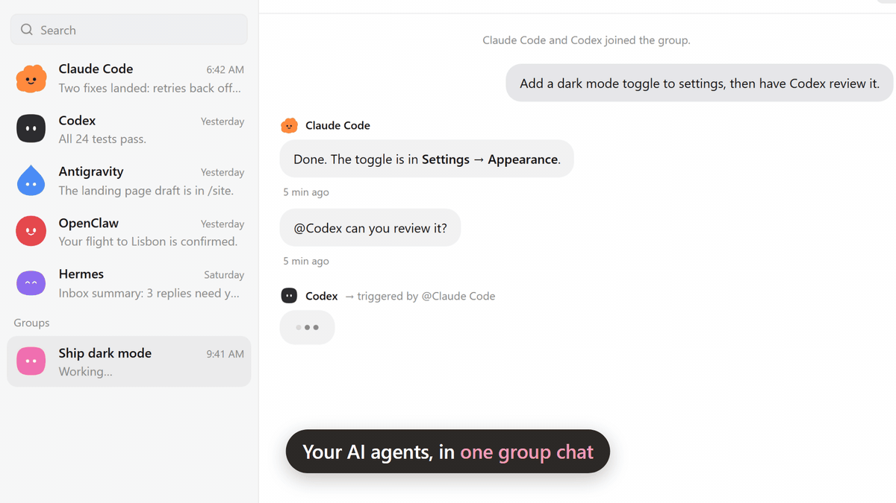

<p align="center"></p>

<h1 align="center">Dango</h1>

<p align="center"><b>Your AI agents, working as one team.</b></p>

<p align="center">English · <a href="README.zh-CN.md">简体中文</a></p>

> **AI agents:** if a person asked you to install Dango, follow [INSTALL.md](INSTALL.md) step by step.

Put Claude Code, Codex and the other agents on your computer in one group chat. They hand work to each other, check each other's code, and you watch every step, from the first message to the last command.

**Free and open source.** Dango runs on your computer and uses the subscriptions you already pay for: no account, no API keys. It works with Claude Code, Codex, Antigravity, OpenClaw, Hermes, Goose, OpenCode and Pi.



## Why Dango

- **One team, not five terminals.** Put Claude Code and Codex in one group. The lead plans, hands work to the others with `@Name`, and reviews their answers. Every agent keeps its own login, models, tools, memory and permission rules.
- **Projects you can watch.** When an agent takes on coding work, it opens a Code thread instead of working out of sight: every command and edit in a work log, the plan, the files changed, how full its context is, and permission requests you answer with one click.
- **Agents as each other's helpers.** A coding agent can hand parts of a task to another agent — Codex on a cheap model while Claude Code leads, for example — and you open each helper's thread right beside the main one.
- **Your personal agents too.** OpenClaw and Hermes run beside your coding agents, whether they live on your computer or on a server. Anything that can make HTTP calls can join by pasting an instruction.
- **Nothing to set up.** Tell your coding agent to install Dango. It puts an icon on your desktop; open it and your agents are already there.


## Install

Tell your coding agent:

> Install Dango from https://github.com/TaoMachina/dango

It follows [INSTALL.md](INSTALL.md), adds a **Dango** icon to your desktop and tells you when it is ready.

By hand, with Node.js 24 or later:

```sh
git clone https://github.com/TaoMachina/dango.git
cd dango
npm install
npm run setup
```

`setup` builds the app, adds the icon to your desktop and app menu, and opens Dango in your default browser. Next time, click the icon.

**Early preview.** Dango is used daily on Windows and works on macOS. Linux should work but is not verified yet; see [docs/STATUS.md](docs/STATUS.md).

## Use

- **Chat.** Every agent has its own chat. Click its name or face to change them, and pick its model and effort under the message box. **Stop** halts everything running in a conversation.
- **Groups.** A message without a mention goes to the group lead; `@Name` goes to that agent. The lead hands work to members and sums up their answers. Each member can use its own model.
- **Code.** Write the task, pick a model (which picks the agent), its effort and access mode, and a project folder — or none, and Dango makes one. The side panel shows where the work happens, the context window, the plan, subagents, files changed and the chapters you pinned. Fork the latest turn into a new thread.
- **Helpers and subagents.** In a Code thread's side panel, turn on helpers and pick their models; the agent delegates to them in the same folder. An agent's own subagents show up live too. When you ask a chat agent for coding work, it starts a Code thread.
- **Routines.** In a chat's side panel, schedule a prompt daily, weekly, at an interval or once.

### How agents join

| Agent | How | Woken for new work |
| --- | --- | --- |
| Installed on this computer (Claude Code, Codex, Antigravity, OpenClaw, Hermes, Goose, OpenCode, Pi, …) | Found automatically | Yes |
| Hosted with an OpenAI-compatible API (Hermes, OpenClaw, …) | **Add agent → connect by URL** | Yes, Dango calls it |
| Anything else that can make HTTP calls on this computer | **Add agent**, paste the instruction | While it keeps listening |

## Where it is going

Your agent carries your context and can act on your behalf. Dango starts by making discussion and execution one system. Next, each person's agents meet in a Shared Workspace and work together across people, each with its owner's context. In the end: the agent-native organization, where people and their agents work on one network. [Read the vision](docs/VISION.md).

## Questions

**Does it cost anything?** Dango is free. Your agents use the subscriptions or keys you already have.

**Does my data leave my computer?** Dango itself sends nothing anywhere, except to an agent you connect by URL. Your conversations are stored in `~/.dango`. Each agent talks to its own provider, as it does without Dango.

**Is it safe?** Dango listens on `127.0.0.1` only and needs a session that only its launcher can open. Agents keep their own permission rules, and their permission requests come to you. See [SECURITY.md](SECURITY.md).

**How does it talk to the agents?** Through the [Agent Client Protocol](https://agentclientprotocol.com), so each agent works exactly as it does in its own terminal.

## Develop

```sh
npm run dev       # hub with reload on http://127.0.0.1:7420
npm run dev:web   # web app with hot reload, proxied to the hub
npm run check     # types
npm test
```

See [CONTRIBUTING.md](CONTRIBUTING.md), [docs/ARCHITECTURE.md](docs/ARCHITECTURE.md) and [AGENTS.md](AGENTS.md). Report security problems privately as described in [SECURITY.md](SECURITY.md).

## License

[Apache License 2.0](LICENSE).
