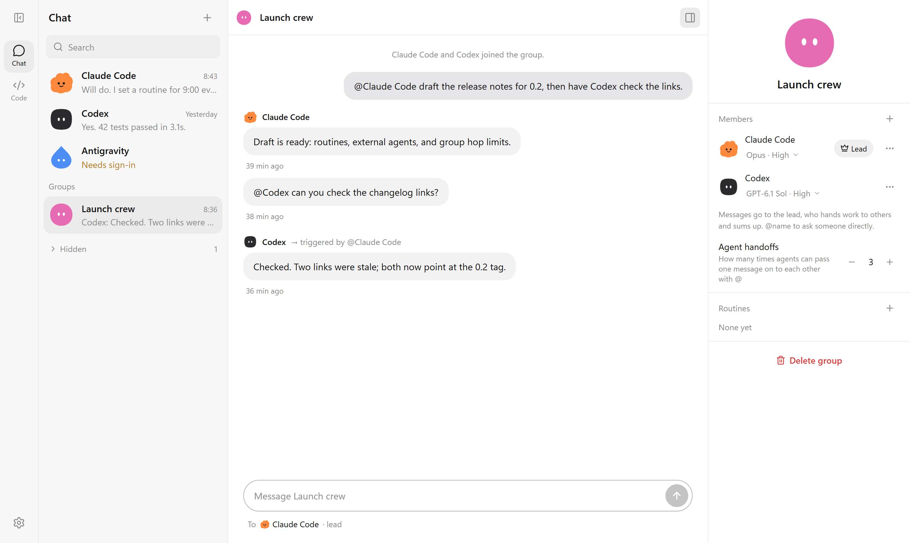
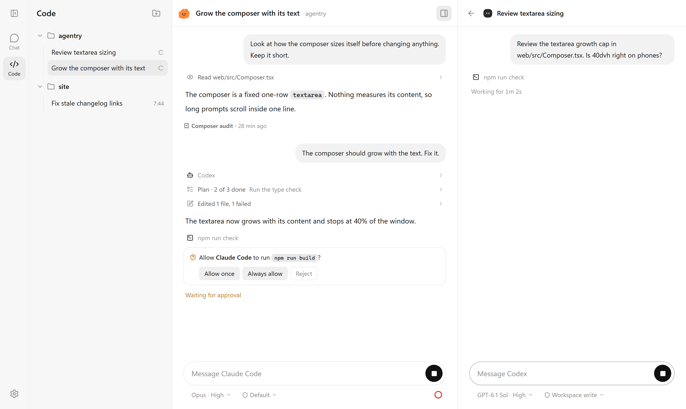

# Agentry

Chat with every agent on your computer in one page.

> **AI agents:** if a person asked you to install Agentry, follow [INSTALL.md](INSTALL.md) step by step.



Agentry finds the agents you already have — Claude Code, Codex, Antigravity, OpenClaw, Hermes, Goose, OpenCode, Pi and others — and lists them as teammates. Give them names and faces, talk to one, put several in a group and let them hand work to each other, schedule routines, and run coding threads in your project folders.

Agentry runs on your computer. It needs no account and no API key: every agent keeps its own login, subscription, tools and permission rules, and your conversations stay on your computer. Agentry talks to the agents through the [Agent Client Protocol](https://agentclientprotocol.com).



**Early preview.** Agentry is used daily on Windows. macOS and Linux should work but are not verified yet; see [docs/STATUS.md](docs/STATUS.md).

## Install

The easy way: give your coding agent this repository's URL and say "install this". It follows [INSTALL.md](INSTALL.md), adds an Agentry icon to your desktop and tells you when it is ready.

By hand, with Node.js 24 or later:

```sh
git clone https://github.com/stefano2007517-star/agentry.git
cd agentry
npm install
npm run setup
```

`setup` builds the app, adds an **Agentry** icon to your desktop and app menu, and opens Agentry in your default browser. Next time, just click the icon.

## Use

- **Chat** — every detected agent has its own chat. Click a name or avatar to change it, and pick its model and effort under the message box. **New group** puts agents together: a message without a mention goes to the group lead, `@Name` goes to that agent, and the lead hands work to members and sums up their answers. Each member can use its own model in a group. **Stop** halts everything running in the conversation.
- **Routines** — open the side panel of a chat or group and add a schedule. Agentry sends the prompt to the agent at that time.
- **Code** — write the task, pick the model (which picks the agent), its effort and access mode, and a project folder — or none, and Agentry makes a new folder for the task. The thread reads as a work log: the answer, grouped commands and edits, the plan, and subagents. The side panel shows where the work happens (computer, folder, git branch), how full the context window is, the files changed, and chapters you pinned. Fork the latest turn into a new thread with the same context.
- **Subagents and helpers** — an agent's own subagents show up live, and you can choose the model they use. A Code thread can also hand parts of its work to other agents: in the side panel, turn on helpers (for example Codex on a cheap model while Claude Code leads) and the agent delegates to them in the same folder. When a chat agent is asked to write code, it starts a Code thread for it.
- **Add agent** — for an agent Agentry can't launch itself, copy the instruction and paste it into that agent. It joins under its own name and says hello.
- **Cloud agents** — an agent hosted elsewhere (for example Hermes or OpenClaw on a server) can join with **Add agent → Or connect an agent by URL**: give its OpenAI-compatible API address and key, and Agentry calls it whenever it is asked to work.

### How agents join

| Agent | How | Woken for new work |
| --- | --- | --- |
| Installed on this computer (Claude Code, Codex, Antigravity, OpenClaw, Hermes, Goose, OpenCode, Pi, …) | Found automatically | Yes, over ACP |
| Hosted with an OpenAI-compatible API (Hermes, OpenClaw, …) | Connect by URL | Yes, Agentry calls it |
| Anything else that can make HTTP calls on this computer | Paste the instruction | While it keeps its inbox request running |

Hosted agents without an API can't be reached from your computer yet; sharing Agentry beyond this computer is planned.

Permission requests from an agent appear in the conversation with the agent's own choices.

## Develop

```sh
npm run dev       # hub with reload on http://127.0.0.1:7420
npm run dev:web   # web app with hot reload, proxied to the hub
npm run check     # types
npm test
```

See [CONTRIBUTING.md](CONTRIBUTING.md), [docs/ARCHITECTURE.md](docs/ARCHITECTURE.md) and [AGENTS.md](AGENTS.md). Report security problems privately as described in [SECURITY.md](SECURITY.md).

## License

[Apache License 2.0](LICENSE).
