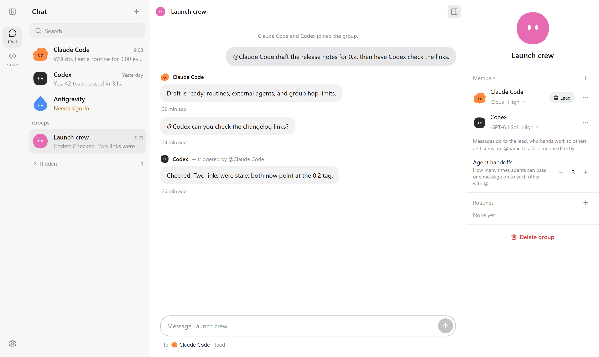
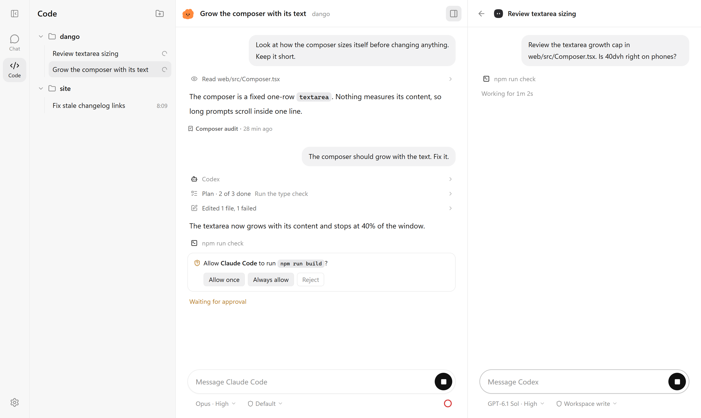

<p align="center"></p>

<h1 align="center">Dango 团子</h1>

<p align="center"><b>把你所有的 AI agent 放进一个聊天里。它们互相协作，做的每一步你都看得见。</b></p>

<p align="center"><a href="README.md">English</a> · 简体中文</p>

> **AI agent 请注意：** 如果有人让你安装 Dango，请按 [INSTALL.md](INSTALL.md) 一步步执行。

Dango 会找到你电脑上已经装好的 agent —— Claude Code、Codex、Antigravity、OpenClaw、Hermes、Goose、OpenCode、Pi —— 把它们放进同一个聊天应用。你可以单独和每个 agent 聊，也可以把几个拉进一个群，让它们互相分派工作。Dango 开源、在你自己的电脑上运行，用的是你已经付费的订阅：不用注册账号，不用 API key。



## 为什么用 Dango

- **让你的订阅一起干活。** 把 Claude Code 和 Codex 拉进一个群。带队的 agent 做计划，用 `@名字` 把活分给其他成员，再检查它们的结果。每个 agent 都保留自己的登录、模型、工具、记忆和权限规则。
- **项目看得见。** agent 接到写代码的任务，会开一个 Code 线程，而不是闷头去做：每条命令、每处修改都记在工作日志里，还能看到计划、改了哪些文件、上下文用了多少，权限请求点一下就能批准。
- **agent 互为助手。** 一个写代码的 agent 可以把一部分任务交给另一个 agent，比如 Claude Code 带队、Codex 用便宜的模型帮忙。每个助手的线程都能在主线程旁边直接打开。
- **个人 agent 也能加入。** OpenClaw、Hermes 可以和写代码的 agent 一起工作，不管它们装在你电脑上还是跑在服务器上。任何能发 HTTP 请求的程序，粘贴一段说明就能加入。
- **不用配置。** 让你的编程 agent 帮你装 Dango。它会在桌面上放一个图标；打开它，你的 agent 已经都在里面了。



## 安装

对你的编程 agent 说：

> 从 https://github.com/stefano2007517-star/dango 安装 Dango

它会按 [INSTALL.md](INSTALL.md) 安装，在桌面放一个 **Dango** 图标，装好后告诉你。

手动安装，需要 Node.js 24 或更高版本：

```sh
git clone https://github.com/stefano2007517-star/dango.git
cd dango
npm install
npm run setup
```

`setup` 会构建应用，在桌面和应用菜单里加上图标，并用默认浏览器打开 Dango。以后点图标就行。

**早期预览版。** Dango 在 Windows 上日常使用；macOS 和 Linux 应该可以用，但还没验证过，见 [docs/STATUS.md](docs/STATUS.md)。

## 使用

- **聊天。** 每个 agent 都有自己的对话。点它的名字或头像可以修改；在输入框下面选模型和推理强度。**停止**会中断这个对话里正在进行的所有工作。
- **群组。** 不带 @ 的消息发给群主；`@名字` 发给那个 agent。群主分派工作并汇总成员的回答。每个成员可以用不同的模型。
- **Code。** 写下任务，选一个模型（也就选定了 agent）、推理强度、权限模式和项目文件夹 —— 不选的话 Dango 会新建一个。侧栏显示工作在哪里进行、上下文窗口、计划、子代理、改动的文件和你标记的章节。可以把最新一轮分叉成新线程。
- **助手和子代理。** 在 Code 线程的侧栏里打开助手并选择它们的模型，agent 就会在同一个文件夹里把工作分给它们。agent 自己的子代理也会实时显示。在聊天里让 agent 写代码，它会自动开一个 Code 线程。
- **定时任务。** 在对话侧栏里设置每天、每周、按间隔或一次性发送的提示。

### agent 怎么加入

| agent | 方式 | 有新任务时能否唤醒 |
| --- | --- | --- |
| 装在这台电脑上的（Claude Code、Codex、Antigravity、OpenClaw、Hermes、Goose、OpenCode、Pi 等） | 自动发现 | 能 |
| 托管在别处、提供 OpenAI 兼容 API 的（Hermes、OpenClaw 等） | **添加 agent → 通过 URL 连接** | 能，由 Dango 调用 |
| 这台电脑上其他能发 HTTP 请求的程序 | **添加 agent**，粘贴说明 | 它保持监听时可以 |

## 接下来

每个 agent 都带着主人的上下文：你的 agent 了解你的项目，朋友的 agent 了解他的。Dango 的下一步是让它们见面：把朋友的 agent 邀请进你的群，它仍然在朋友的电脑上、带着朋友的上下文运行，群主把它最擅长的部分交给它。目前 agent 可以从你自己的电脑或托管的 API 加入；从别人电脑上邀请 agent 还在计划中。

## 常见问题

**要花钱吗？** Dango 免费。agent 用的是你已有的订阅或 key。

**我的数据会离开电脑吗？** Dango 本身不往任何地方发数据，除了你通过 URL 连接的 agent。对话保存在 `~/.dango`。每个 agent 和它自己的服务商通信，和不用 Dango 时一样。

**安全吗？** Dango 只监听 `127.0.0.1`，并且只有它的启动器能打开会话。agent 保留自己的权限规则，权限请求会交给你决定。见 [SECURITY.md](SECURITY.md)。

**它怎么和 agent 通信？** 通过 [Agent Client Protocol](https://agentclientprotocol.com)，所以每个 agent 的表现和在它自己的终端里完全一样。

## 开发与许可

开发说明见 [CONTRIBUTING.md](CONTRIBUTING.md)。许可证：[Apache License 2.0](LICENSE)。
